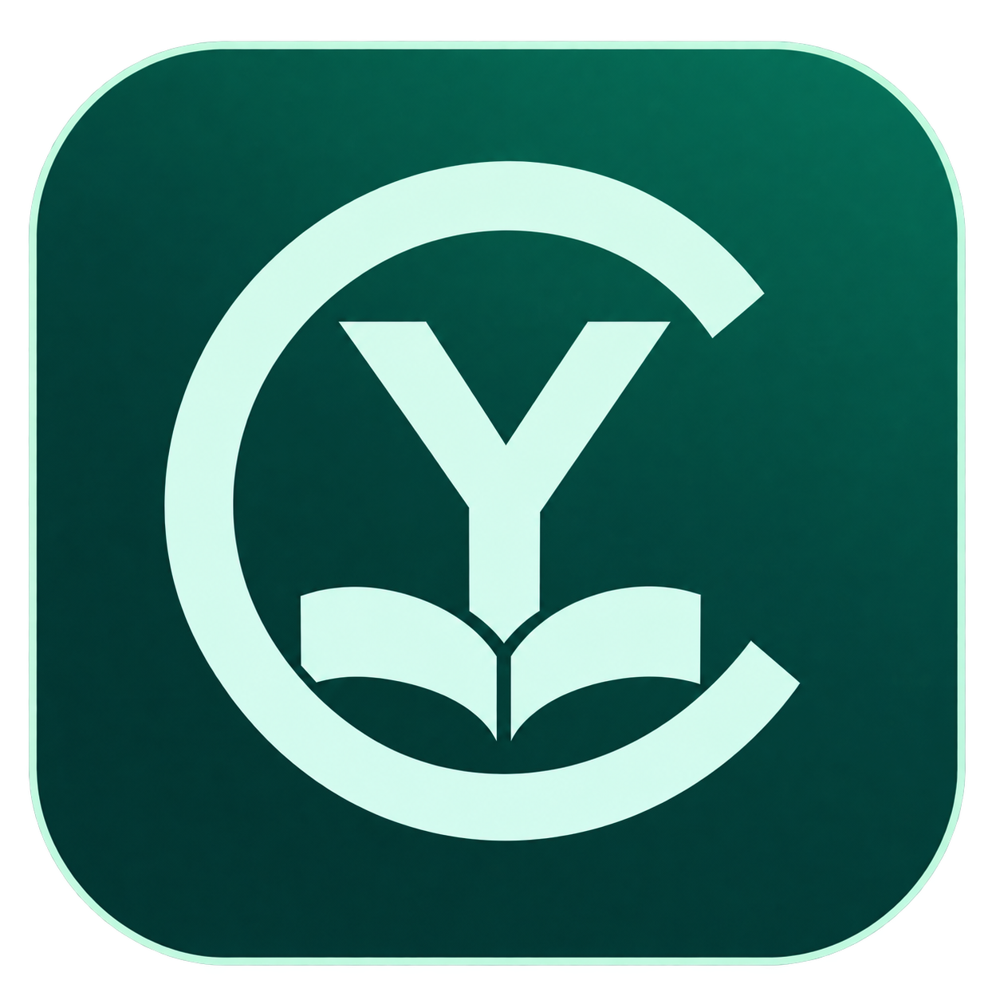
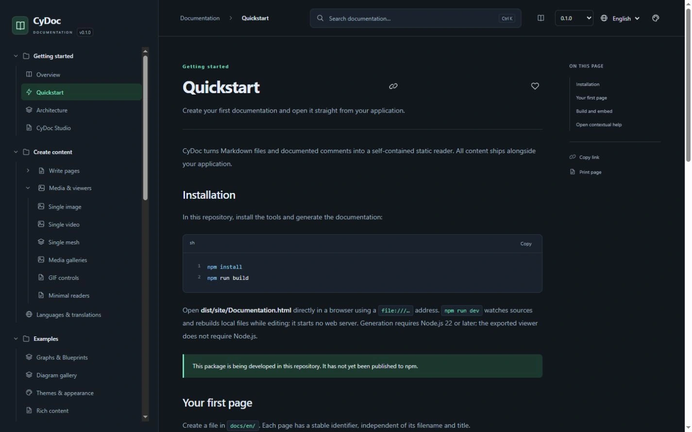
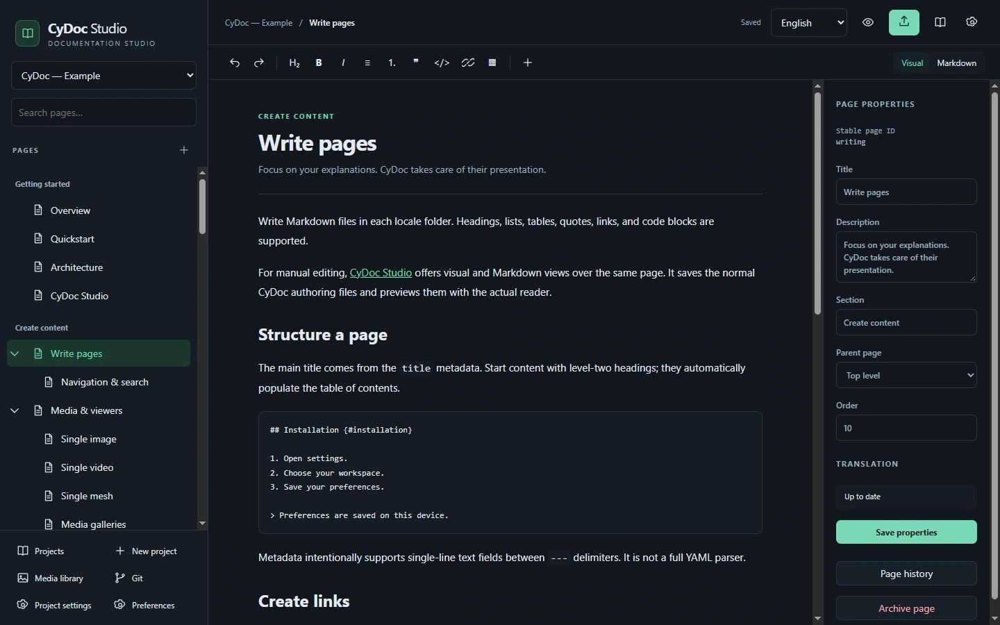

<table class="readme-header" width="100%">
  <tr>
    <td width="300" align="left" valign="top">
      <a href="https://mrmybal.github.io/CyDoc/?lang=fr">Présentation</a><br>
      <a href="https://mrmybal.github.io/CyDoc/manual/Documentation.html#/fr/overview">Manuel</a><br>
      <a href="https://github.com/MrMybal/CyDoc">GitHub</a><br><br>
      <sub>README</sub><br>
      <a href="README.md">English</a> · <a href="README.fr.md">Français</a>
    </td>
    <td width="400" align="center" valign="middle">
      <a href="https://mrmybal.github.io/CyDoc/?lang=fr"></a>
    </td>
    <td width="300" align="right" valign="top">
      <p><sub>Licence de l’application</sub><br><a href="LICENSE"><strong>MIT</strong></a></p>
      <p><sub>Versions</sub><br><a href="VERSION.fr.md"><strong>Lecteur 0.2.0</strong><br><strong>Studio 0.2.0</strong></a><br><strong>EN DÉVELOPPEMENT</strong></p>
      <p><a href="https://github.com/MrMybal/CyDoc/releases/tag/v0.2.0"><strong>Télécharger Studio 0.2.0</strong></a><br><sub>Windows x64 · Linux x64 (X11)</sub></p>
    </td>
  </tr>
</table>

<h1 align="center">CyDoc</h1>
<p align="center">By <a href="https://github.com/MrMybal">CyberAlien</a></p>

Bibliothèque de documentation modulaire pour les développeurs d’applications et de plugins. Rédigez des manuels illustrés, ouvrez la bonne explication depuis votre application et livrez un lecteur avec recherche qui fonctionne directement depuis des fichiers locaux. L’éditeur optionnel **CyDoc Studio** ajoute l’écriture visuelle et Markdown.

> **EN DÉVELOPPEMENT · Lecteur 0.2.0 · Studio 0.2.0**
>
> Il s’agit d’une première implémentation avec un éditeur Windows et Linux. Les intégrations natives et la compatibilité des médias nécessitent encore des vérifications sur les cibles. Consultez les [notes de version et limites connues](VERSION.fr.md).

[](website/assets/screenshots/reader-guide.webp)

## L’application

CyDoc sépare le manuel de l’application qui le crée. Rédigez des guides ou générez des références d’API annotées, puis distribuez `Documentation.html` avec son dossier `DocData/`. Les lecteurs peuvent chercher, suivre l’aide contextuelle et explorer les illustrations sans installer Studio ni lancer de serveur. Le même export peut être hébergé sur un site statique.

Studio fournit un éditeur visuel/Markdown, une arborescence, l’import de médias, les propriétés des pages et un aperçu du véritable lecteur. Les projets locaux ne nécessitent aucun compte et peuvent utiliser des dossiers ordinaires sans Git. Un service en ligne hébergé séparément gère les comptes et l’édition simultanée. Ses dépendances restent séparées des manuels exportés.

[](website/assets/screenshots/studio-visual.webp)

## Fonctionnalités

- **Aide contextuelle** : liens stables vers les pages, sections, lignes de code, annotations, positions temporelles, nœuds et vues 3D enregistrées.
- **Manuels pour les humains** : navigation arborescente, recherche locale, six thèmes, favoris, notes privées et positions de lecture conservées.
- **Anglais et français** : originaux anglais et traduction française complète et à jour exigés avant publication.
- **Médias optionnels** : lecteurs d’images, vidéos, GIF, meshes, galeries et graphes. Inclure seulement les modules nécessaires ; seul le mesh utilise Three.js.
- **Contenu technique** : coloration du code à la compilation, schémas SVG, extraction d’annotations, imports Doxygen/TypeDoc et références d’API sans affichage des implémentations brutes.
- **Écriture et automatisation optionnelles** : édition visuelle/Markdown, Git facultatif, collaboration hébergée, Studio Windows/Linux et SDK/MCP local via CyMCPSDK.

### Compatibilité et limites

Le lecteur cible les navigateurs et WebViews modernes sur Windows, Linux, macOS et Android. Les exemples d’intégration native nécessitent une validation sur vos appareils. Les paquets natifs Studio ciblent **Windows x64** et **Linux x64 sous X11**, validé sur Ubuntu 24.04. Studio pour macOS n’est pas fourni. Les codecs vidéo, le stockage local et WebGL dépendent de l’environnement.

Consultez les [limites documentées et le suivi des problèmes](VERSION.fr.md#limites-documentées) avant de choisir votre cible.

---

Studio 0.2.0 utilise CyMCPSDK 0.7.5 pour l’assistant intégré et l’automatisation locale, et CyInstaller 0.1.0 pour le setup, les mises à jour gérées et le retour arrière sous Windows et Linux X11. Consultez les [notes de version](VERSION.fr.md).

## Installation

### Installer Studio sous Windows ou Linux

1. Téléchargez le [setup Windows x64](https://github.com/MrMybal/CyDoc/releases/download/v0.2.0/CyDocStudio-0.2.0-win-x64-setup.exe) ou le [setup Linux x64](https://github.com/MrMybal/CyDoc/releases/download/v0.2.0/CyDocStudio-0.2.0-linux-x64-setup.run).
2. Fermez toute ancienne copie de Studio. Lancez le setup Windows ou, sous Linux, `chmod +x CyDocStudio-0.2.0-linux-x64-setup.run` puis `./CyDocStudio-0.2.0-linux-x64-setup.run`. Utilisez une destination distincte et vide pour migrer depuis une copie portable.
3. Lancez Studio et choisissez **Open the CyDoc example**, ou créez un projet local. Aucun compte n’est requis en local.

CyInstaller gère les mises à jour et le retour arrière ; les projets et préférences restent hors de l’installation. Python, Node et CEF sont inclus. Linux nécessite X11, OpenGL 3.3, GTK 3, GLFW et libcurl ; Ubuntu 24.04 x64 est la cible testée. Les [notes de release, paquets portables, setups en ligne et sommes SHA-256](https://github.com/MrMybal/CyDoc/releases/tag/v0.2.0) accompagnent les deux installeurs. Les mises à jour utilisent des signatures Ed25519 ; Authenticode Windows n’est pas configuré. Le pont Python/CEF fonctionne sans le bac à sable de processus CEF ; ouvrez des projets de confiance.

### Utiliser la bibliothèque ou l’éditeur dans le navigateur

La compilation depuis le dépôt nécessite Node.js 22+ et npm. La bibliothèque du lecteur n’est pas encore publiée sur npm. Après compilation, ouvrez `dist/site/Documentation.html` directement via `file://` ; le dossier généré complet peut accompagner une application. La lecture ne nécessite ni Node.js, ni serveur.

```text
App/
  .CyDocBuild/                 # Sources, médias et outils de génération
  Documentation/
    Documentation.html        # Ouvrir directement pour lire le manuel
    DocAI.md                  # Guide séparé pour les agents
    DocData/                  # Scripts, manifestes, médias et notices
```

La configuration d’une application se trouve dans `.CyDocBuild/cydoc.config.json`. Ce dépôt conserve sa propre documentation de démonstration dans `docs/` et `assets/`. Les liens contextuels ciblent le véritable lecteur HTML, par exemple `Documentation.html#/fr/quickstart/installation`.

## Sources, compilation et bibliothèques nécessaires

<details>
<summary>Compiler la bibliothèque et lancer éventuellement l’éditeur dans le navigateur</summary>

```sh
git clone https://github.com/MrMybal/CyDoc.git
cd CyDoc
npm ci
npm run build
```

La compilation utilise TypeScript, marked, PrismJS et esbuild. Three.js est nécessaire uniquement pour le mesh. Pour préparer une archive locale de la bibliothèque, lancez `npm pack` depuis le dépôt ; ne la remplacez pas par un paquet du registre portant le même nom.

Pour l’éditeur local sans compte :

```sh
npm ci --prefix studio
npm run build --prefix studio
npm start --prefix studio -- --local --data ./data --port 4310
```

Ouvrez `http://127.0.0.1:4310`. Le service est nécessaire pendant l’écriture ; les manuels exportés restent statiques. L’hébergement en ligne utilise un service authentifié distinct, un stockage persistant, HTTPS et WebSockets. La compilation Windows nécessite aussi Python 3.11+, MSVC, CMake 3.24+, libcurl, CyUI, CyMCPSDK 0.7.5 et des fichiers CEF correspondants ; suivez le [guide de compilation de Studio](https://github.com/MrMybal/CyDoc/blob/main/studio/README.md#build-windows).


### Construire un manuel ou une vitrine

Depuis ce dépôt compilé, générez le manuel de votre application avec sa configuration :

```sh
node tools/cli.mjs build /path/to/App/.CyDocBuild/cydoc.config.json
```

Le chemin est un exemple à adapter. Livrez tout le dossier exporté. Pour une présentation statique bilingue avec le vrai lecteur HTML :

```sh
npm run website:build
npm run website:preview
```

Le résultat est dans `dist/website/` ; son `index.html` peut aussi s’ouvrir directement. Voir les [sources de la vitrine](https://github.com/MrMybal/CyDoc/blob/main/website/README.md), les [exemples d’intégration](examples/integrations/) et les [formats d’import d’API](examples/api/README.md). `npm run dev` est un observateur de compilation sans serveur. Pour vérifier le code : `npm test`, `npm run check` et `npm run size`.

</details>

---

## Licence

**CyDoc et CyDoc Studio utilisent la [licence MIT](LICENSE).** Copyright © 2026 CyDoc contributors. Les bibliothèques tierces conservent leurs licences ; celle de l’application ne remplace pas leurs conditions.

### Lecteur, génération et développement

Le cœur n’a aucune dépendance à l’exécution. Les outils de génération ne s’exécutent pas dans le lecteur exporté.

| Bibliothèque · sources | Licence · texte | Utilisation / périmètre |
| --- | --- | --- |
| [Three.js](https://github.com/mrdoob/three.js) | [MIT](https://github.com/mrdoob/three.js/blob/r187/LICENSE) | Lecteur mesh optionnel uniquement ; sa notice accompagne les exports mesh. |
| [marked](https://github.com/markedjs/marked) | [MIT](https://github.com/markedjs/marked/blob/v17.0.1/LICENSE.md) | Compilation du Markdown lors de la génération. |
| [PrismJS](https://github.com/PrismJS/prism) | [MIT](https://github.com/PrismJS/prism/blob/v1.30.0/LICENSE) | Coloration syntaxique lors de la génération. |
| [esbuild](https://github.com/evanw/esbuild) | [MIT](https://github.com/evanw/esbuild/blob/v0.25.12/LICENSE.md) | Assemblage de la bibliothèque, du lecteur, de l’éditeur et de la vitrine. |
| [TypeScript](https://github.com/microsoft/TypeScript) | [Apache-2.0](https://github.com/microsoft/TypeScript/blob/v5.9.3/LICENSE.txt) | Vérification des types et compilation pendant le développement. |
| [Happy DOM](https://github.com/capricorn86/happy-dom) | [MIT](https://github.com/capricorn86/happy-dom/blob/v21.0.4/LICENSE) | Fixtures DOM de développement ; absent du moteur du lecteur. |

### Éditeur et service Studio optionnels

| Bibliothèque · sources | Licence · texte | Utilisation / périmètre |
| --- | --- | --- |
| [Paquets libres Tiptap](https://github.com/ueberdosis/tiptap) | [MIT](https://github.com/ueberdosis/tiptap/blob/main/LICENSE.md) | Écriture visuelle via les paquets libres. |
| [ProseMirror](https://github.com/ProseMirror) | [MIT](https://github.com/ProseMirror/prosemirror-state/blob/master/LICENSE) | Modèle d’édition utilisé par Tiptap. |
| [CodeMirror](https://github.com/codemirror) | [MIT](https://github.com/codemirror/state/blob/main/LICENSE) | Édition Markdown. |
| [Yjs](https://github.com/yjs/yjs) | [MIT](https://github.com/yjs/yjs/blob/main/LICENSE) | État partagé pour la collaboration. |
| [ws](https://github.com/websockets/ws) | [MIT](https://github.com/websockets/ws/blob/master/LICENSE) | WebSockets du service. |
| [fflate](https://github.com/101arrowz/fflate) | [MIT](https://github.com/101arrowz/fflate/blob/master/LICENSE) | Export ZIP. |

### Interface Windows et automatisation locale optionnelles

| Bibliothèque · sources | Licence · texte | Utilisation / périmètre |
| --- | --- | --- |
| [CyUI](https://github.com/MrMybal/CyUI) | [MIT](https://github.com/MrMybal/CyUI/blob/main/LICENSE) | Interface native et adaptateur CEF ; l’accès aux sources peut nécessiter une autorisation. |
| [CyMCPSDK](https://github.com/MrMybal/CyMCPSDK) | [MIT](https://github.com/MrMybal/CyMCPSDK/blob/main/LICENSE) | Exécution des opérations SDK/MCP locales. |
| [CyInstaller](https://github.com/MrMybal/CyInstaller) | [MIT](https://github.com/MrMybal/CyInstaller/blob/main/LICENSE) | Moteur d’installation et de mise à jour de Studio. |
| [Dear ImGui](https://github.com/ocornut/imgui) | [MIT](https://github.com/ocornut/imgui/blob/docking/LICENSE.txt) | Interface native via CyUI/imgui-bundle. |
| [imgui-bundle](https://github.com/pthom/imgui_bundle) | [MIT et notices des composants](https://github.com/pthom/imgui_bundle/blob/main/LICENSE) | Dépendance Python/native ; ses composants gardent leurs notices. |
| [CEF / Chromium](https://bitbucket.org/chromiumembedded/cef) | [De type BSD et notices des composants](https://bitbucket.org/chromiumembedded/cef/src/master/LICENSE.txt) | Navigateur intégré ; conserver LICENSE.txt et CREDITS.html. |
| [Node.js](https://github.com/nodejs/node) | [MIT et notices des composants](https://github.com/nodejs/node/blob/main/LICENSE) | Moteur du service Studio inclus. |
| [CPython](https://github.com/python/cpython) | [PSF et notices des composants](https://github.com/python/cpython/blob/3.11/LICENSE) | Exécution du SDK natif et de l’automatisation. |
| [SDK MCP Python](https://github.com/modelcontextprotocol/python-sdk) | [MIT](https://github.com/modelcontextprotocol/python-sdk/blob/main/LICENSE) | Transport MCP de l’automatisation locale. |
| [Pillow](https://github.com/python-pillow/Pillow) | [MIT-CMU](https://github.com/python-pillow/Pillow/blob/main/LICENSE) | Utilitaires d’image natifs. |
| [PyOpenGL](https://github.com/mcfletch/pyopengl) | [De type BSD](https://github.com/mcfletch/pyopengl/blob/master/license.txt) | Accès natif à OpenGL. |
| [PyInstaller](https://github.com/pyinstaller/pyinstaller) | [GPLv2-or-later avec exception du chargeur](https://github.com/pyinstaller/pyinstaller/blob/v6.22.3/COPYING.txt) | Outil de paquetage Windows ; l’exception ne change pas la licence de CyDoc. |

Le tableau est un index. Conservez les [notices de Studio](https://github.com/MrMybal/CyDoc/blob/main/studio/LICENCES.md), les fichiers `.LEGAL.txt` de l’éditeur, `LICENCES/`, les notices des composants Python et les crédits du navigateur. Les composants supplémentaires gardent leurs conditions propres.

## Références et liens

- [Manuel français](https://mrmybal.github.io/CyDoc/manual/Documentation.html#/fr/overview) · [English manual](https://mrmybal.github.io/CyDoc/manual/Documentation.html#/en/overview).
- [Présentation](https://mrmybal.github.io/CyDoc/?lang=fr) · [Installation de Studio](https://github.com/MrMybal/CyDoc/blob/main/studio/README.md).
- [Dépôt des sources](https://github.com/MrMybal/CyDoc) · [Releases](https://github.com/MrMybal/CyDoc/releases) · [Suivi des problèmes](https://github.com/MrMybal/CyDoc/issues).

<details>
<summary><strong>AI Usage</strong></summary>

- [Commencer ici : guide IA principal](ai/README.md) — présentation du projet et liens vers les guides importants.
- [Intégrer la bibliothèque](ai/INTEGRATION.md) — créer et livrer le manuel local d’une application.
- [Rédiger la documentation](ai/AUTHORING.md) · [Contrats de l’API](ai/API.md) — pages, médias, traductions et intégration de modules.
- [SDK/MCP de Studio](ai/STUDIO.md) — automatisation locale et édition en ligne optionnelle.
- [Créer une vitrine d’application](ai/showcase/README.md) — présentation statique bilingue complète.
- [Créer ou mettre à jour un README](ai/readme/DocAI.md) — appliquer cette convention à un autre projet.

</details>
