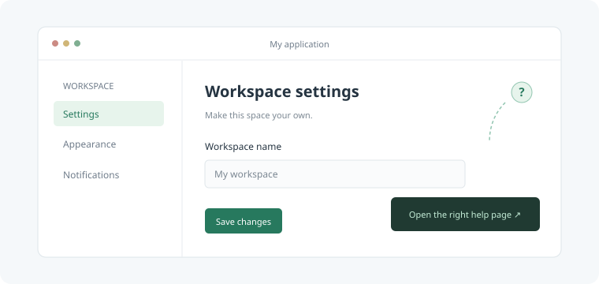

# CyDoc

A lightweight, modular documentation library for applications. Multilingual by design, MIT licensed, and readable directly from local files without a web server.

CyDoc combines handwritten guides, documentation extracted from source annotations, structured API imports, and optional media viewers in one framework-independent reader. It is designed for browsers and WebViews on Windows, Linux, macOS, and Android.

**Status:** functional version 0.1.0. Not published to npm yet. Native integrations are provided as source examples; target-device validation is still required.

## Quick start

Requirements: Node.js 22 or later and npm.

```sh
npm ci
npm run build
```

Open `web/index.html` or `dist/site/index.html` directly in your browser. The first file redirects to the generated reader while preserving the URL fragment and query string.

```text
file:///path/to/CyDoc/dist/site/index.html#/en/quickstart/installation
```

The generated `dist/site/` directory contains the reader, documentation, styles, and local assets. Copy the entire directory into your application distribution. Reading requires no Node.js installation, network connection, or web server.

```sh
npm run dev    # Rebuild on local changes; refresh the file in your browser
npm test       # Build and run the automated tests
npm run check  # Check TypeScript types
npm run size   # Measure core, reader, data, and optional module bundles
```

`npm run dev` watches local files and does not start a server.

## Features

- Stable links to pages, sections, source lines, annotations, playback times, graph nodes, and 3D views.
- French and English example content, locale fallback, and translation revision reports.
- Local search across prose, code, and symbols, with language/content filters and typo tolerance.
- Build-time syntax highlighting for C++, Python, HLSL, GLSL, C#, C, JavaScript, Java, and TypeScript. Native examples also use Kotlin and Swift.
- Code tabs, step-by-step guides, callouts, collapsible content, glossary tooltips, and code diffs.
- SVG flow, decision, sequence, class, dependency, and architecture diagrams compiled at build time.
- Six themes, keyboard navigation, a page outline, code copying, and print support.
- Local bookmarks, recent pages, reading positions, and exportable private notes.
- Independent media modules loaded on demand.
- Local documentation versions, redirects, cross-documentation links, and source file indexes.

## Core library

The core has no runtime dependencies and does not use the DOM.

```ts
import { createDocumentation, createLink } from 'cydoc';

const docs = createDocumentation(manifest);
const page = docs.resolve('quickstart', 'en');
const results = docs.search('installation', 'en');

const url = createLink({
  locale: 'en',
  pageId: 'quickstart',
  anchor: 'installation'
}, './help/index.html');
```

Mount the optional reader in a dedicated page:

```ts
import { mountViewer } from 'cydoc/viewer';
import 'cydoc/viewer.css';

const viewer = mountViewer(document.querySelector('#app')!, manifest, {
  initialTheme: 'nord',
  storageId: 'my-application-help'
});

// Release event listeners and active media readers.
viewer.destroy();
```

The reader uses the URL fragment and a global CSS reset. Use a dedicated page or iframe when integrating into an existing UI. Pass a compiler-generated manifest, or HTML sanitized by your application, to `mountViewer`.

## Optional media modules

The core and main reader do not import a media viewer or a 3D engine. The host selects the modules it needs.

| Module | Capabilities |
| --- | --- |
| `image` | Fullscreen, zoom, pan, synchronized A/B transforms, draggable comparison handle, arrow/area annotations, local persistence, JSON export. Native GIF display also works here. |
| `video` | Browser-supported codec variants, playback speed, timed annotations, fullscreen, synchronized A/B playback, and nominal frame stepping. |
| `mesh` | GLB/glTF, PBR, orbit/pan/zoom, lighting presets, glTF scenes, wireframe, A/B comparison, surface annotations, and saved camera views. |
| `gif` | Local GIF raster decoding, pause, scrubbing, frame stepping, zoom/pan, and time-synchronized comparison. |
| `gallery` | Image, video, mesh, GIF, or mixed galleries. Only the active item's reader is mounted. |
| `graph` | Typed ports, curved connections, comment groups, selection, pan/zoom, fullscreen, and documentation links. |

For generated exports:

```json
{
  "modules": ["image", "video", "gallery"]
}
```

Omit `modules` to distribute no optional readers. Include the child readers required by a gallery. The repository demo enables all six modules. Previously generated module scripts are removed when disabled.

For JavaScript integrations:

```ts
const viewer = mountViewer(document.querySelector('#app')!, manifest, {
  modules: {
    image: () => import('cydoc/modules/image').then(m => m.default),
    video: () => import('cydoc/modules/video').then(m => m.default),
    gallery: () => import('cydoc/modules/gallery').then(m => m.default),
    gif: () => import('cydoc/modules/gif').then(m => m.default),
    graph: () => import('cydoc/modules/graph').then(m => m.default)
    // Add mesh only when needed, and install its optional peer dependency, three.
  }
});
```

`MediaModule.mount(host, config, context)` receives the locale, an `AbortSignal`, local asset/module providers, and optional reader state. It returns a cleanup function, optionally asynchronously. Custom modules can use this contract through the JavaScript API.

GLB/glTF resources and controllable GIF files are packaged as classic local scripts loaded on demand. This avoids file-fetch restrictions when opening the generated reader through `file://`. A custom embedding supplies `loadAsset(src)`, returning `{ base64, resources? }`; the generated bootstrap configures it automatically.

Media limitations:

- Video playback uses browser decoders. Supply appropriate `sources` and `compareSources` variants for your devices. CyDoc does not transcode video.
- Video stepping advances by `1 / fps` seconds, with `fps` defaulting to 30. Browser seeking and variable frame rates do not guarantee encoded-frame accuracy.
- The mesh module requires WebGL 2 and uses the optional MIT-licensed Three.js peer. Draco/KTX2 decoders are not bundled. Labels are not occlusion-tested or tracked semantically between scenes. Comparison models should share a coordinate system and scale.
- The optional GIF raster decoder supports palettes, transparency, interlacing, and disposal methods 0–3. Its default decoded memory budget is 64 MiB per file, configurable with `maxDecodedMiB` up to 256 MiB.
- The graph module imports JSON and a common subset of Unreal Blueprint clipboard text. It does not execute graphs, edit them, parse `.uasset` files, or interpret every Unreal/plugin metadata field. No BlueprintUE service is used.

## Writing documentation

```text
docs/fr/*.md       French pages
docs/en/*.md       English pages
assets/           Local images, videos, GIFs, and meshes
examples/         Annotated source and integration examples
src/index.ts      DOM-free core
src/viewer.ts     Framework-independent reader
tools/            Markdown compilation, API imports, extraction, and export
```

Each Markdown page starts with simple, single-line metadata:

```markdown
---
id: settings
title: Application settings
description: Configure your workspace.
section: Guides
order: 10
---

## Export settings {#export}

[Installation](doc:quickstart#installation)


```

Translated pages share the same `id`. Explicit section anchors keep contextual links stable across languages. The metadata format does not support advanced YAML.

Media blocks accept JSON, for example:

````markdown
```image
{"id":"workspace","src":"assets/settings.svg","compare":"assets/settings-b.svg","alt":"Workspace settings"}
```
````

Rich blocks use `tabs`, `steps`, `callout`, `details`, `glossary`, or `diff`. See the **Rich content** page in the generated demo and `docs/en/rich-content.md` for complete examples.

Raw HTML is escaped. Script links and remote media are rejected. Media must remain inside `assets/`; distribute assets from trusted authors.

## Precise contextual links

```ts
const url = createLink({
  locale: 'en',
  pageId: 'video-viewer',
  state: { media: 'intro', time: '1.25', note: 'step-1' }
}, './help/index.html');
```

The state query is inside the URL fragment. Set an explicit media `id` to keep links stable when rearranging a page. A reader's link icon copies its current view.

| Target | State fields |
| --- | --- |
| Image | `zoom`, `x`, `y`, `note` |
| Video | `time`, `note` |
| GIF | `frame`, `zoom`, `x`, `y` |
| Mesh | `camera`, `target`, `scene`, `wire`, `environment`, `note` |
| Graph | `node`, `zoom`, `x`, `y` |
| Comparison | `wipe` |
| Gallery | `item`, plus the active reader's state |

Camera vectors contain three comma-separated numbers. Source lines use `L1`, `L2`, and so on in the first code block, then `code-2-L1` in the second block. Reader-created annotations remain private: their identifiers only resolve on devices where those annotations exist.

## Source extraction and API imports

Add explicit Markdown documentation to source comments:

```ts
/**
 * @doc settings
 * @locale en
 * @title Application settings
 * @section API
 * @symbol configureSettings
 * Describe the feature in Markdown.
 *
 * ## Parameters {#parameters}
 * Explain the inputs here.
 */
```

Python triple-quoted docstrings accept the same tags. Declare source directories in `sources` in `cydoc.config.json`.

Enable a source index to generate highlighted file pages, documented-symbol links, and resolvable local dependencies:

```json
{
  "sources": ["examples"],
  "sourceIndex": {
    "enabled": true,
    "includeDirs": ["examples/cpp/include", "examples/shaders"]
  }
}
```

This index is lexical. It recognizes common includes, imports, modules, and namespaces without compiler semantics. It does not expand macros, evaluate conditional compilation, infer overloads/types, or fully resolve packages. C# XML comments are not converted. Annotation markers inside string literals can be mistaken for comments.

Structured API imports run at build time:

```json
{
  "apiImports": [
    { "format": "doxygen", "path": "generated/xml", "prefix": "cpp-api" },
    { "format": "typedoc", "path": "generated/typedoc.json", "prefix": "ts-api" }
  ]
}
```

Adapters consume common [Doxygen XML](https://www.doxygen.nl/manual/output.html) and [TypeDoc JSON](https://typedoc.org/documents/Options.Output.html) declarations, including signatures, parameters, returns, inheritance, references, and indexed source lines. Doxygen and TypeDoc are not included in the reader.

The neutral `cydoc` format lets other producers supply the same information for additional languages. Its illustrative schema and generation configurations are in `examples/api/README.md`. Demo snapshots are small interchange examples maintained alongside their source; adapters do not cover all plugin-specific metadata.

## Versions, translations, and linked manuals

Declare local versions:

```json
{
  "version": "2.0",
  "versions": [
    { "id": "1.0", "label": "1.0", "base": "../v1/index.html" },
    { "id": "2.0", "label": "2.0", "base": "./index.html" }
  ],
  "aliases": { "old-page": "new-page#section" },
  "translationReport": true
}
```

The current version's `id` matches `version`. Switching versions preserves the locale, page, section, and media state. Each version is a separate local export. Aliases preserve renamed page addresses; cycles and missing destinations fail the build.

The repository includes two small **Demo v1 / Demo v2** manuals to demonstrate switching and translation freshness. They are not historical CyDoc releases. Optional `versionBuilds` entries build child projects and copy their exports into controlled subdirectories of the main export.

Every build writes `translation-report.json`. Set `translationReport: true` to include a report page. Put `revision` on an original page and the translated revision in `sourceRevision` on its translation. Missing, outdated, and untracked translations are reported separately. Without an explicit original revision, the generator uses a content fingerprint.

Link to another manual with `[Export](doc://editor/settings#export)` and a host-owned catalog:

```json
{
  "linkedDocs": {
    "editor": {
      "base": "../editor/help/index.html",
      "manifest": "../editor/help/manifest.json"
    }
  }
}
```

The optional manifest validates destination pages and sections during generation. A catalog entry can fix `locale`; otherwise the current locale is retained. The application must distribute the other manual at its declared path. The core also provides `createDocumentationRegistry()` for programmatic cross-manual links.

## Personal reading tools

**My space** stores bookmarks, recent pages, and private notes on the device, with a JSON export for backup. **Resume reading** returns to a saved page position. Explicit section and media links retain priority.

Storage availability depends on the browser or WebView, particularly for file origins. The UI reports when notes cannot be persisted and offers export. `storageId` gives the host control over the data namespace. No feedback or personal notes are sent to a server.

## Native integration examples

`examples/integrations/` contains:

- A header-only C++17 link helper and a Qt 6 Widgets F1 example for Windows, Linux, and macOS.
- A Python/Tk F1 example using platform file URLs.
- A Windows C#/WinForms component.
- A Java/Swing F1 example.
- A Swift/AppKit help controller.
- An Android Kotlin/WebView Activity and manifest fragment.
- A JavaScript F1 binding with a host-provided opening callback.

Copy the generated reader into your application's `help/` directory. Android's example opens `file:///android_asset/help/index.html` directly, without a web server or Internet permission. Native frameworks remain dependencies of the host application. The examples are included in the npm archive; Qt, AppKit, and Android interfaces still require target-device validation.

## Build another project's manual

From a built or locally installed package:

```sh
cydoc build path/to/cydoc.config.json
cydoc check path/to/cydoc.config.json
```

Both commands build and validate the export. Paths are relative to the configuration file; `out` must be a project subdirectory. Each declared locale needs a directory in `content`, and the asset directory must exist. Source directories and optional modules are configurable.

`homePage` selects the initial page. The repository's `landingPage: true` enables the CyDoc demo landing page; omit it for your own manual. A custom JavaScript embedding can provide trusted `renderHome(locale)` HTML.

Generated data and disabled module scripts are updated during a build. Old copied media assets are not automatically removed; use a fresh output directory for a clean application distribution.

## Compatibility and limits

- The reader targets modern browsers and WebViews. Validate native integrations, codecs, storage, and WebGL support on your target devices.
- All pages currently load together. Very large documentation sets will need segmented content and search indexes.
- Additional content locales are supported by the schema; the current UI is translated into French and English. RTL layout is not implemented.
- `marked`, `prismjs`, and `esbuild` are generation dependencies. Syntax highlighting is compiled into the exported pages rather than shipped as a reader runtime.
- The optional `three` peer is only needed for mesh integration. Installing CyDoc without the mesh module does not require it.

## License

[MIT](LICENSE). Third-party dependency licenses remain with their respective authors. Mesh exports include the Three.js license notice.
