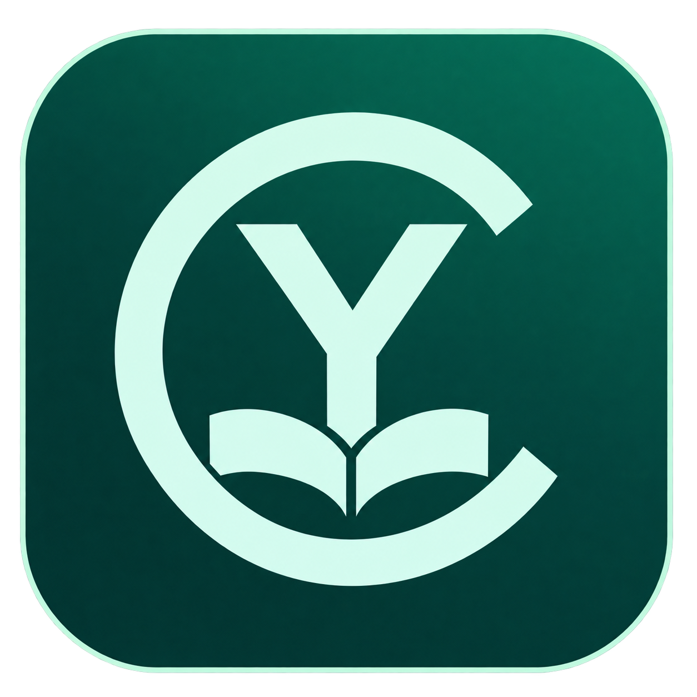
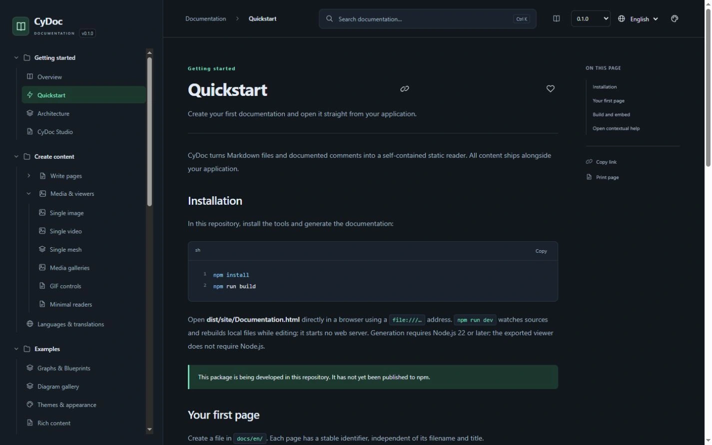
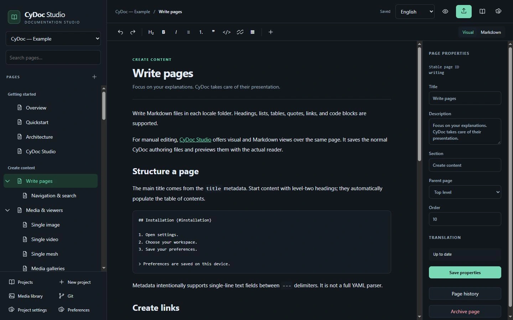

<div class="readme-header">
  <p align="center"><a href="https://mrmybal.github.io/CyDoc/"></a></p>
  <h1 align="center">CyDoc</h1>
  <p align="center">By <a href="https://github.com/MrMybal">CyberAlien</a></p>
  <p align="center">
    <a href="https://mrmybal.github.io/CyDoc/">Website</a> ·
    <a href="https://mrmybal.github.io/CyDoc/manual/Documentation.html#/en/overview">Documentation</a> ·
    <a href="https://github.com/MrMybal/CyDoc">GitHub</a> ·
    <a href="https://github.com/MrMybal/CyDoc/releases/download/studio-v0.1.2/CyDocStudio-0.1.2-windows-x64.zip">Download Studio · Windows x64</a><br>
    <a href="README.md">English</a> · <a href="README.fr.md">Français</a>
  </p>
  <p align="center">
    <a href="LICENSE"><strong>MIT license</strong></a><br>
    <a href="VERSION.md">Reader <strong>0.1.0</strong> · Studio <strong>0.1.2</strong></a><br>
    <strong>IN DEVELOPMENT</strong>
  </p>
</div>

A modular documentation library for application and plug-in developers. Write illustrated manuals, open the right explanation from your application and ship a searchable reader that works directly from local files. The optional **CyDoc Studio** editor adds visual and Markdown authoring.

> **IN DEVELOPMENT · Reader 0.1.0 · Studio 0.1.2**
>
> This is an early implementation with a published Windows editor. Native integrations and media compatibility still need target validation. Read the [version notes and known limitations](VERSION.md).

[](website/assets/screenshots/reader-guide.webp)

## The application

CyDoc separates the manual from the application that creates it. Write guides or generate annotated API references, then distribute `Documentation.html` with its `DocData/` directory. Readers can search, follow contextual links and explore illustrations without installing Studio or running a server. The same export can be hosted on a static website.

Studio provides visual/Markdown editing, a page tree, media import, page properties and a real reader preview. Local projects need no account and can use ordinary folders without Git. A separately hosted online service supports accounts and simultaneous editing. Its dependencies remain separate from exported manuals.

[](website/assets/screenshots/studio-visual.webp)

## Features

- **Contextual help:** stable links to pages, sections, code lines, annotations, media times, graph nodes and saved 3D views.
- **Human-readable manuals:** nested navigation, local search, six themes, bookmarks, private notes and remembered reading positions.
- **English and French:** English originals and complete, current French translations are required for publication.
- **Optional media:** image, video, GIF, mesh, gallery and graph viewers. Include only the modules needed by the manual; only mesh uses Three.js.
- **Technical content:** build-time code highlighting, SVG diagrams, annotated source extraction, Doxygen/TypeDoc imports and API references without raw implementation listings.
- **Optional authoring tools:** visual/Markdown editing, optional Git, hosted collaboration, Windows Studio and local SDK/MCP automation through CyToolsCore.

### Compatibility and limits

The reader targets modern browsers and WebViews on Windows, Linux, macOS and Android. Native integration examples need validation on your devices. The supplied native Studio package is for **Windows x64**. Video codecs, local storage and WebGL depend on the runtime.

Review the [documented limits and issue tracking](VERSION.md#documented-limitations) before choosing a target.

---

## Installation

### Use the Windows editor

1. [Download CyDoc Studio 0.1.2 for Windows x64](https://github.com/MrMybal/CyDoc/releases/download/studio-v0.1.2/CyDocStudio-0.1.2-windows-x64.zip).
2. Extract the complete archive and start `CyDocStudio.exe`. Keep `app/`, `runtime/` and `LICENCES/` beside it.
3. Choose **Open the CyDoc example**, or create a local project. Local use requires no account.

The application is portable. Its runtimes are bundled. [Release notes and checksums](https://github.com/MrMybal/CyDoc/releases/tag/studio-v0.1.2) accompany the ZIP. The current Windows Python/CEF bridge runs without the CEF process sandbox; open trusted projects.

### Use the library or browser editor

Use Node.js 22+ and npm to build from the source checkout. The reader library is not published to npm yet. After building, open `dist/site/Documentation.html` directly through `file://`; the complete generated folder can travel with an application. Reading needs no Node.js or server.

```text
App/
  .CyDocBuild/                 # Authored content, media and generation tools
  Documentation/
    Documentation.html        # Open directly to read the manual
    DocAI.md                  # Separate agent guidance
    DocData/                  # Scripts, manifests, media and notices
```

An application’s configuration lives in `.CyDocBuild/cydoc.config.json`. This checkout keeps its own maintained demo in `docs/` and `assets/`. Contextual links address the actual HTML reader, for example `Documentation.html#/en/quickstart/installation`.

## Source, build and required libraries

<details>
<summary>Build the library and optionally run the browser editor</summary>

```sh
git clone https://github.com/MrMybal/CyDoc.git
cd CyDoc
npm ci
npm run build
```

The build uses TypeScript, marked, PrismJS and esbuild. Three.js is needed only for mesh support. To prepare a local library archive, run `npm pack` from the checkout; do not substitute a registry package with the same name.

For the account-free browser editor:

```sh
npm ci --prefix studio
npm run build --prefix studio
npm start --prefix studio -- --local --data ./data --port 4310
```

Open `http://127.0.0.1:4310`. An editing service is needed while authoring; exported manuals remain static. Online hosting uses a separate authenticated service, persistent storage, HTTPS and WebSockets. Windows source builds additionally need Python 3.11+, MSVC, CyUI, CyToolsCore and matching CEF files; follow the [Studio build guide](https://github.com/MrMybal/CyDoc/blob/main/studio/README.md#build-windows).


### Build a manual or a showcase

From this built checkout, generate an application manual with its configuration:

```sh
node tools/cli.mjs build /path/to/App/.CyDocBuild/cydoc.config.json
```

Replace the example path with your configuration. Ship the entire exported folder. For a bilingual static presentation with the actual HTML reader:

```sh
npm run website:build
npm run website:preview
```

The result is in `dist/website/`; its `index.html` also opens directly. See the [showcase sources](https://github.com/MrMybal/CyDoc/blob/main/website/README.md), [integration examples](examples/integrations/) and [API import formats](examples/api/README.md). `npm run dev` watches builds without starting a server. To check code changes: `npm test`, `npm run check` and `npm run size`.

</details>

---

## License

**CyDoc and CyDoc Studio use the [MIT license](LICENSE).** Copyright © 2026 CyDoc contributors. Third-party libraries retain their own licenses; the application's license does not replace their terms.

### Reader, generation and development

The core has no runtime dependencies. Generation tools do not run inside the exported reader.

| Library · source | License · terms | Use / scope |
| --- | --- | --- |
| [Three.js](https://github.com/mrdoob/three.js) | [MIT](https://github.com/mrdoob/three.js/blob/r187/LICENSE) | Optional mesh viewer only; its notice is included with mesh exports. |
| [marked](https://github.com/markedjs/marked) | [MIT](https://github.com/markedjs/marked/blob/v17.0.1/LICENSE.md) | Build-time Markdown compilation. |
| [PrismJS](https://github.com/PrismJS/prism) | [MIT](https://github.com/PrismJS/prism/blob/v1.30.0/LICENSE) | Build-time syntax highlighting. |
| [esbuild](https://github.com/evanw/esbuild) | [MIT](https://github.com/evanw/esbuild/blob/v0.25.12/LICENSE.md) | Library, reader, editor and showcase bundling. |
| [TypeScript](https://github.com/microsoft/TypeScript) | [Apache-2.0](https://github.com/microsoft/TypeScript/blob/v5.9.3/LICENSE.txt) | Type checking and compilation during development/builds. |
| [Happy DOM](https://github.com/capricorn86/happy-dom) | [MIT](https://github.com/capricorn86/happy-dom/blob/v21.0.4/LICENSE) | Development-only DOM fixtures; not a reader runtime. |

### Optional Studio editor and service

| Library · source | License · terms | Use / scope |
| --- | --- | --- |
| [Tiptap open source packages](https://github.com/ueberdosis/tiptap) | [MIT](https://github.com/ueberdosis/tiptap/blob/main/LICENSE.md) | Visual authoring through the open source packages. |
| [ProseMirror](https://github.com/ProseMirror) | [MIT](https://github.com/ProseMirror/prosemirror-state/blob/master/LICENSE) | Editing model used by Tiptap. |
| [CodeMirror](https://github.com/codemirror) | [MIT](https://github.com/codemirror/state/blob/main/LICENSE) | Markdown editing. |
| [Yjs](https://github.com/yjs/yjs) | [MIT](https://github.com/yjs/yjs/blob/main/LICENSE) | Collaborative document state. |
| [ws](https://github.com/websockets/ws) | [MIT](https://github.com/websockets/ws/blob/master/LICENSE) | Service WebSockets. |
| [fflate](https://github.com/101arrowz/fflate) | [MIT](https://github.com/101arrowz/fflate/blob/master/LICENSE) | ZIP export. |

### Optional Windows shell and local automation

| Library · source | License · terms | Use / scope |
| --- | --- | --- |
| [CyUI](https://github.com/MrMybal/CyUI) | [MIT](https://github.com/MrMybal/CyUI/blob/main/LICENSE) | Native interface and CEF adapter; source access may require permission. |
| [CyToolsCore](https://github.com/MrMybal/CyToolsCore) | [MIT](https://github.com/MrMybal/CyToolsCore/blob/main/LICENSE) | Local SDK/MCP operation runtime. |
| [Dear ImGui](https://github.com/ocornut/imgui) | [MIT](https://github.com/ocornut/imgui/blob/docking/LICENSE.txt) | Native UI through CyUI/imgui-bundle. |
| [imgui-bundle](https://github.com/pthom/imgui_bundle) | [MIT and component notices](https://github.com/pthom/imgui_bundle/blob/main/LICENSE) | Python/native UI dependency; its components retain separate notices. |
| [CEF / Chromium](https://bitbucket.org/chromiumembedded/cef) | [BSD-style and component notices](https://bitbucket.org/chromiumembedded/cef/src/master/LICENSE.txt) | Embedded browser; retain LICENSE.txt and CREDITS.html. |
| [Node.js](https://github.com/nodejs/node) | [MIT and component notices](https://github.com/nodejs/node/blob/main/LICENSE) | Bundled Studio service runtime. |
| [CPython](https://github.com/python/cpython) | [PSF and component notices](https://github.com/python/cpython/blob/3.11/LICENSE) | Native SDK and automation runtime. |
| [MCP Python SDK](https://github.com/modelcontextprotocol/python-sdk) | [MIT](https://github.com/modelcontextprotocol/python-sdk/blob/main/LICENSE) | MCP transport used by local automation. |
| [Pillow](https://github.com/python-pillow/Pillow) | [MIT-CMU](https://github.com/python-pillow/Pillow/blob/main/LICENSE) | Native image helpers. |
| [PyOpenGL](https://github.com/mcfletch/pyopengl) | [BSD-style](https://github.com/mcfletch/pyopengl/blob/master/license.txt) | Native OpenGL bindings. |
| [PyInstaller](https://github.com/pyinstaller/pyinstaller) | [GPLv2-or-later with bootloader exception](https://github.com/pyinstaller/pyinstaller/blob/v6.22.3/COPYING.txt) | Windows packaging tool; the exception does not relicense CyDoc. |

The component table is an index. Preserve the [Studio notices](https://github.com/MrMybal/CyDoc/blob/main/studio/LICENCES.md), editor `.LEGAL.txt` files, native `LICENCES/`, Python component notices and browser credits. Additional components keep their own terms.

## References and links

- [English manual](https://mrmybal.github.io/CyDoc/manual/Documentation.html#/en/overview) · [Manuel en français](https://mrmybal.github.io/CyDoc/manual/Documentation.html#/fr/overview).
- [Product website](https://mrmybal.github.io/CyDoc/) · [Studio setup](https://github.com/MrMybal/CyDoc/blob/main/studio/README.md).
- [Source repository](https://github.com/MrMybal/CyDoc) · [Releases](https://github.com/MrMybal/CyDoc/releases) · [Issue tracker](https://github.com/MrMybal/CyDoc/issues).

<details>
<summary><strong>AI Usage</strong></summary>

- [Start here: primary AI guide](ai/README.md) — project overview and important agent guides.
- [Integrate the library](ai/INTEGRATION.md) — build and ship an application's offline manual.
- [Author documentation](ai/AUTHORING.md) · [API contracts](ai/API.md) — pages, media, translations and module integration.
- [Studio SDK/MCP](ai/STUDIO.md) — local automation and optional online editing.
- [Build an application showcase](ai/showcase/README.md) — a complete bilingual static presentation.
- [Create or update a README](ai/readme/DocAI.md) — apply this README convention to another project.

</details>
