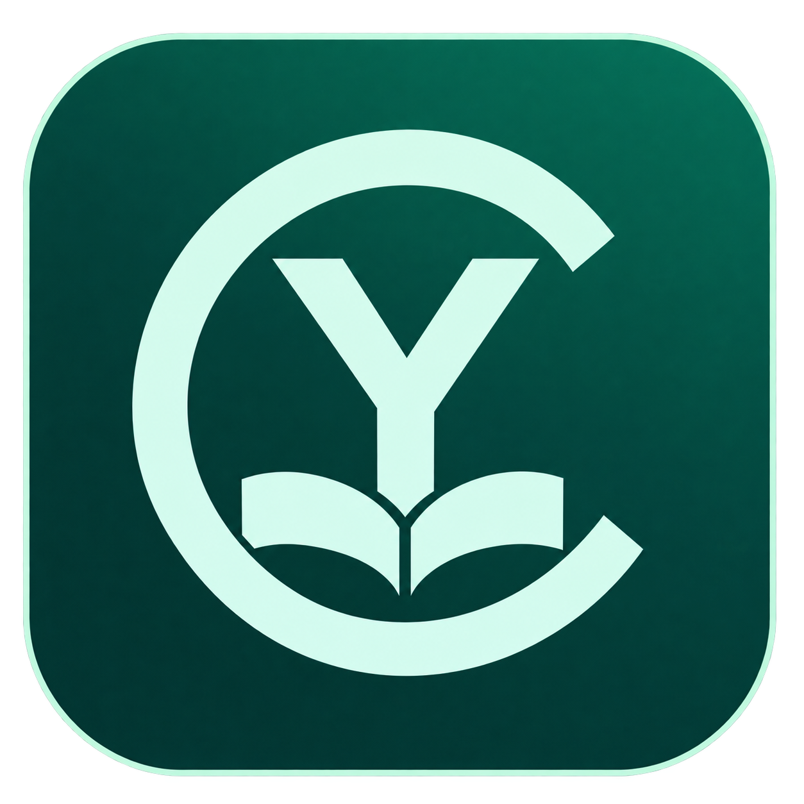
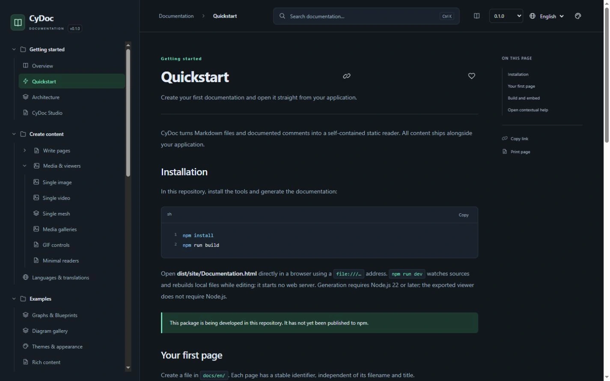
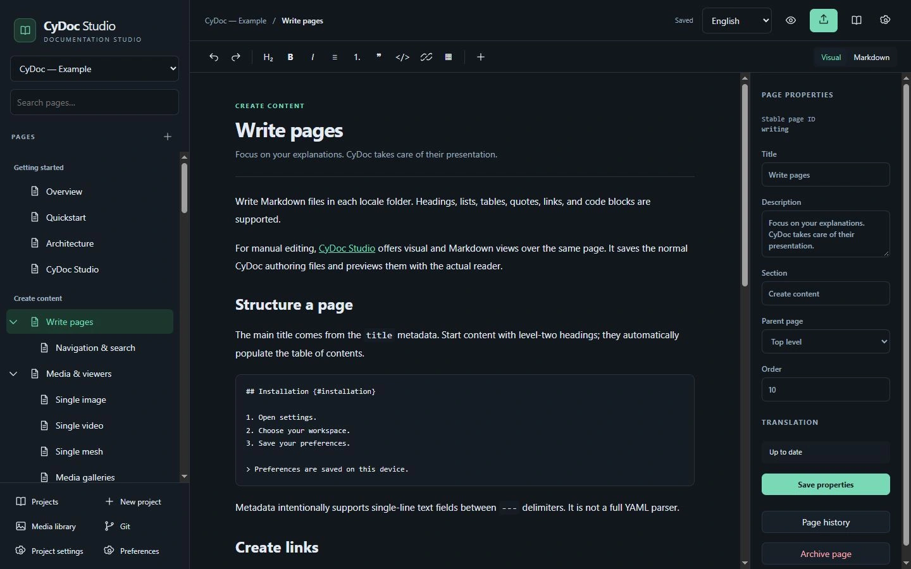

<table class="readme-header" width="100%">
  <tr>
    <td width="300" align="left" valign="top">
      <a href="https://mrmybal.github.io/CyDoc/?lang=fr">Présentation</a><br>
      <a href="https://mrmybal.github.io/CyDoc/manual/Documentation.html#/fr/overview">Manuel</a><br>
      <a href="https://github.com/MrMybal/CyDoc">GitHub</a><br><br>
      <sub>README</sub><br>
      <a href="README.md">English</a> · <a href="README.fr.md">Français</a>
    </td>
    <td width="400" align="center" valign="middle">
      <a href="https://mrmybal.github.io/CyDoc/?lang=fr"></a>
    </td>
    <td width="300" align="right" valign="top">
      <p><sub>Licence de l’application</sub><br><a href="../../../LICENSE"><strong>MIT</strong></a></p>
      <p><sub>Versions</sub><br><a href="VERSION.fr.md"><strong>Lecteur 0.1.0</strong><br><strong>Studio 0.1.2</strong></a><br><strong>EN DÉVELOPPEMENT</strong></p>
      <p><a href="https://github.com/MrMybal/CyDoc/releases/download/studio-v0.1.2/CyDocStudio-0.1.2-windows-x64.zip"><strong>Télécharger Studio</strong></a><br><sub>Windows x64 · portable</sub></p>
    </td>
  </tr>
</table>

<h1 align="center">CyDoc</h1>
<p align="center">By <a href="https://github.com/MrMybal">CyberAlien</a></p>

Bibliothèque de documentation modulaire pour les développeurs d’applications et de plugins. Rédigez des manuels illustrés, ouvrez la bonne explication depuis votre application et livrez un lecteur avec recherche qui fonctionne directement depuis des fichiers locaux. L’éditeur optionnel **CyDoc Studio** ajoute l’écriture visuelle et Markdown.

> **EN DÉVELOPPEMENT · Lecteur 0.1.0 · Studio 0.1.2**
>
> Il s’agit d’une première implémentation avec un éditeur Windows publié. Les intégrations natives et la compatibilité des médias nécessitent encore des vérifications sur les cibles. Consultez les [notes de version et limites connues](VERSION.fr.md).

[](assets/reader.webp)

## L’application

CyDoc sépare le manuel de l’application qui le crée. Rédigez des guides ou générez des références d’API annotées, puis distribuez `Documentation.html` avec son dossier `DocData/`. Les lecteurs peuvent chercher, suivre l’aide contextuelle et explorer les illustrations sans installer Studio ni lancer de serveur. Le même export peut être hébergé sur un site statique.

Studio fournit un éditeur visuel/Markdown, une arborescence, l’import de médias, les propriétés des pages et un aperçu du véritable lecteur. Les projets locaux ne nécessitent aucun compte et peuvent utiliser des dossiers ordinaires sans Git. Un service en ligne hébergé séparément gère les comptes et l’édition simultanée. Ses dépendances restent séparées des manuels exportés.

[](assets/studio.webp)

## Fonctionnalités

- **Aide contextuelle** : liens stables vers les pages, sections, lignes de code, annotations, positions temporelles, nœuds et vues 3D enregistrées.
- **Manuels pour les humains** : navigation arborescente, recherche locale, six thèmes, favoris, notes privées et positions de lecture conservées.
- **Anglais et français** : originaux anglais et traduction française complète et à jour exigés avant publication.
- **Médias optionnels** : lecteurs d’images, vidéos, GIF, meshes, galeries et graphes. Inclure seulement les modules nécessaires ; seul le mesh utilise Three.js.
- **Contenu technique** : coloration du code à la compilation, schémas SVG, extraction d’annotations, imports Doxygen/TypeDoc et références d’API sans affichage des implémentations brutes.
- **Écriture et automatisation optionnelles** : édition visuelle/Markdown, Git facultatif, collaboration hébergée, Studio Windows et SDK/MCP local via CyToolsCore.

---

## Installation

### Utiliser l’éditeur Windows

1. [Téléchargez CyDoc Studio 0.1.2 pour Windows x64](https://github.com/MrMybal/CyDoc/releases/download/studio-v0.1.2/CyDocStudio-0.1.2-windows-x64.zip).
2. Extrayez toute l’archive et lancez `CyDocStudio.exe`. Gardez `app/`, `runtime/` et `LICENCES/` à côté.
3. Choisissez **Open the CyDoc example**, ou créez un projet local. Aucun compte n’est requis en local.

L’application est portable et ses moteurs d’exécution sont inclus. Les [notes de release et sommes de contrôle](https://github.com/MrMybal/CyDoc/releases/tag/studio-v0.1.2) accompagnent le ZIP. Le pont Windows Python/CEF actuel s’exécute sans le bac à sable de processus CEF ; ouvrez des projets de confiance.

### Utiliser la bibliothèque ou l’éditeur dans le navigateur

La compilation depuis le dépôt nécessite Node.js 22+ et npm. La bibliothèque du lecteur n’est pas encore publiée sur npm. Après compilation, ouvrez `dist/site/Documentation.html` directement via `file://` ; le dossier généré complet peut accompagner une application. La lecture ne nécessite ni Node.js, ni serveur.

## Sources, compilation et bibliothèques nécessaires

<details>
<summary>Compiler la bibliothèque et lancer éventuellement l’éditeur dans le navigateur</summary>

```sh
git clone https://github.com/MrMybal/CyDoc.git
cd CyDoc
npm ci
npm run build
```

La compilation utilise TypeScript, marked, PrismJS et esbuild. Three.js est nécessaire uniquement pour le mesh. Pour préparer une archive locale de la bibliothèque, lancez `npm pack` depuis le dépôt ; ne la remplacez pas par un paquet du registre portant le même nom.

Pour l’éditeur local sans compte :

```sh
npm ci --prefix studio
npm run build --prefix studio
npm start --prefix studio -- --local --data ./data --port 4310
```

Ouvrez `http://127.0.0.1:4310`. Le service est nécessaire pendant l’écriture ; les manuels exportés restent statiques. L’hébergement en ligne utilise un service authentifié distinct, un stockage persistant, HTTPS et WebSockets. La compilation Windows nécessite aussi Python 3.11+, MSVC, CyUI, CyToolsCore et des fichiers CEF correspondants ; suivez le [guide de compilation de Studio](https://github.com/MrMybal/CyDoc/blob/main/studio/README.md#build-windows).

</details>

---

## Licence

**CyDoc et CyDoc Studio utilisent la [licence MIT](../../../LICENSE).** Copyright © 2026 CyDoc contributors. Les bibliothèques tierces conservent leurs licences ; celle de l’application ne remplace pas leurs conditions.

### Lecteur, génération et développement

Le cœur n’a aucune dépendance à l’exécution. Les outils de génération ne s’exécutent pas dans le lecteur exporté.

| Bibliothèque · sources | Licence · texte | Utilisation / périmètre |
| --- | --- | --- |
| [Three.js](https://github.com/mrdoob/three.js) | [MIT](https://github.com/mrdoob/three.js/blob/r187/LICENSE) | Lecteur mesh optionnel uniquement ; sa notice accompagne les exports mesh. |
| [marked](https://github.com/markedjs/marked) | [MIT](https://github.com/markedjs/marked/blob/v17.0.1/LICENSE.md) | Compilation du Markdown lors de la génération. |
| [PrismJS](https://github.com/PrismJS/prism) | [MIT](https://github.com/PrismJS/prism/blob/v1.30.0/LICENSE) | Coloration syntaxique lors de la génération. |
| [esbuild](https://github.com/evanw/esbuild) | [MIT](https://github.com/evanw/esbuild/blob/v0.25.12/LICENSE.md) | Assemblage de la bibliothèque, du lecteur, de l’éditeur et de la vitrine. |
| [TypeScript](https://github.com/microsoft/TypeScript) | [Apache-2.0](https://github.com/microsoft/TypeScript/blob/v5.9.3/LICENSE.txt) | Vérification des types et compilation pendant le développement. |
| [Happy DOM](https://github.com/capricorn86/happy-dom) | [MIT](https://github.com/capricorn86/happy-dom/blob/v21.0.4/LICENSE) | Fixtures DOM de développement ; absent du moteur du lecteur. |

### Éditeur et service Studio optionnels

| Bibliothèque · sources | Licence · texte | Utilisation / périmètre |
| --- | --- | --- |
| [Paquets libres Tiptap](https://github.com/ueberdosis/tiptap) | [MIT](https://github.com/ueberdosis/tiptap/blob/main/LICENSE.md) | Écriture visuelle via les paquets libres. |
| [ProseMirror](https://github.com/ProseMirror) | [MIT](https://github.com/ProseMirror/prosemirror-state/blob/master/LICENSE) | Modèle d’édition utilisé par Tiptap. |
| [CodeMirror](https://github.com/codemirror) | [MIT](https://github.com/codemirror/state/blob/main/LICENSE) | Édition Markdown. |
| [Yjs](https://github.com/yjs/yjs) | [MIT](https://github.com/yjs/yjs/blob/main/LICENSE) | État partagé pour la collaboration. |
| [ws](https://github.com/websockets/ws) | [MIT](https://github.com/websockets/ws/blob/master/LICENSE) | WebSockets du service. |
| [fflate](https://github.com/101arrowz/fflate) | [MIT](https://github.com/101arrowz/fflate/blob/master/LICENSE) | Export ZIP. |

### Interface Windows et automatisation locale optionnelles

| Bibliothèque · sources | Licence · texte | Utilisation / périmètre |
| --- | --- | --- |
| [CyUI](https://github.com/MrMybal/CyUI) | [MIT](https://github.com/MrMybal/CyUI/blob/main/LICENSE) | Interface native et adaptateur CEF ; l’accès aux sources peut nécessiter une autorisation. |
| [CyToolsCore](https://github.com/MrMybal/CyToolsCore) | [MIT](https://github.com/MrMybal/CyToolsCore/blob/main/LICENSE) | Exécution des opérations SDK/MCP locales. |
| [Dear ImGui](https://github.com/ocornut/imgui) | [MIT](https://github.com/ocornut/imgui/blob/docking/LICENSE.txt) | Interface native via CyUI/imgui-bundle. |
| [imgui-bundle](https://github.com/pthom/imgui_bundle) | [MIT et notices des composants](https://github.com/pthom/imgui_bundle/blob/main/LICENSE) | Dépendance Python/native ; ses composants gardent leurs notices. |
| [CEF / Chromium](https://bitbucket.org/chromiumembedded/cef) | [De type BSD et notices des composants](https://bitbucket.org/chromiumembedded/cef/src/master/LICENSE.txt) | Navigateur intégré ; conserver LICENSE.txt et CREDITS.html. |
| [Node.js](https://github.com/nodejs/node) | [MIT et notices des composants](https://github.com/nodejs/node/blob/main/LICENSE) | Moteur du service Studio inclus. |
| [CPython](https://github.com/python/cpython) | [PSF et notices des composants](https://github.com/python/cpython/blob/3.11/LICENSE) | Exécution du SDK natif et de l’automatisation. |
| [SDK MCP Python](https://github.com/modelcontextprotocol/python-sdk) | [MIT](https://github.com/modelcontextprotocol/python-sdk/blob/main/LICENSE) | Transport MCP de l’automatisation locale. |
| [Pillow](https://github.com/python-pillow/Pillow) | [MIT-CMU](https://github.com/python-pillow/Pillow/blob/main/LICENSE) | Utilitaires d’image natifs. |
| [PyOpenGL](https://github.com/mcfletch/pyopengl) | [De type BSD](https://github.com/mcfletch/pyopengl/blob/master/license.txt) | Accès natif à OpenGL. |
| [PyInstaller](https://github.com/pyinstaller/pyinstaller) | [GPLv2-or-later avec exception du chargeur](https://github.com/pyinstaller/pyinstaller/blob/v6.22.3/COPYING.txt) | Outil de paquetage Windows ; l’exception ne change pas la licence de CyDoc. |

Le tableau est un index. Conservez les [notices de Studio](https://github.com/MrMybal/CyDoc/blob/main/studio/LICENCES.md), les fichiers `.LEGAL.txt` de l’éditeur, `LICENCES/`, les notices des composants Python et les crédits du navigateur. Les composants supplémentaires gardent leurs conditions propres.

## Références et liens

- [Manuel français](https://mrmybal.github.io/CyDoc/manual/Documentation.html#/fr/overview) · [English manual](https://mrmybal.github.io/CyDoc/manual/Documentation.html#/en/overview).
- [Présentation](https://mrmybal.github.io/CyDoc/?lang=fr) · [Installation de Studio](https://github.com/MrMybal/CyDoc/blob/main/studio/README.md).
- [Dépôt des sources](https://github.com/MrMybal/CyDoc) · [Releases](https://github.com/MrMybal/CyDoc/releases) · [Suivi des problèmes](https://github.com/MrMybal/CyDoc/issues).

<details>
<summary><strong>AI Usage</strong></summary>

- [Commencer ici : guide IA principal](../../README.md) — présentation du projet et liens vers les guides importants.
- [Intégrer la bibliothèque](../../INTEGRATION.md) — créer et livrer le manuel local d’une application.
- [Rédiger la documentation](../../AUTHORING.md) · [Contrats de l’API](../../API.md) — pages, médias, traductions et intégration de modules.
- [SDK/MCP de Studio](../../STUDIO.md) — automatisation locale et édition en ligne optionnelle.
- [Créer une vitrine d’application](../../showcase/README.md) — présentation statique bilingue complète.
- [Créer ou mettre à jour un README](../DocAI.md) — appliquer cette convention à un autre projet.

</details>
